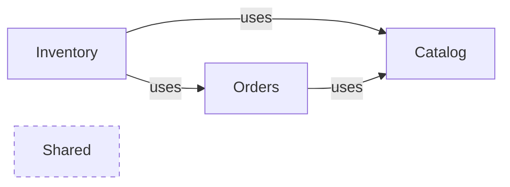

# Docs

Base package: `io.quarkiverse.modulith.deployment.docs.fixtures.app`

| Module | Base package | Type | Depends on | Allowed dependencies |
|---|---|---|---|---|
| Catalog | `io.quarkiverse.modulith.deployment.docs.fixtures.app.catalog` | closed |  | any |
| Inventory | `io.quarkiverse.modulith.deployment.docs.fixtures.app.inventory` | closed | catalog, order | any |
| Orders | `io.quarkiverse.modulith.deployment.docs.fixtures.app.order` | closed | catalog | any |
| Shared | `io.quarkiverse.modulith.deployment.docs.fixtures.app.shared` | open |  | any |
